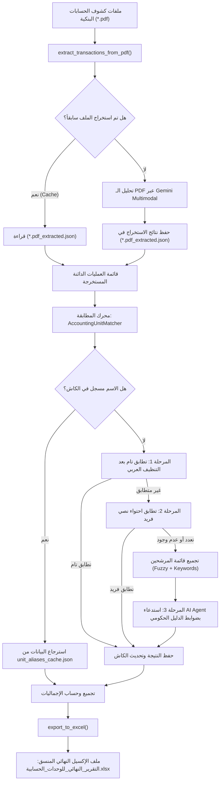

# 🏦 Bank Statements Reconciliation Agent
### نظام المطابقة والتحليل الذكي لكشوف الحسابات البنكية الحكومية (منظومة الدفع والتحصيل الإلكتروني - e-Finance)

نظام متكامل ومؤتمت لمعالجة كشوف الحسابات البنكية الصادرة بصيغة PDF عن منظومة الدفع الإلكتروني الحكومية المصرية (`e-finance`). يقوم النظام باستخراج العمليات الدائنة آلياً، ومطابقة أسماء الجهات المرسلة غير النمطية مع الدليل الرسمي للوحدات الحسابية، وتعيين الأكواد المؤسسية (الرئيسية والفرعية)، ثم تصدير تقرير محاسبي تنفيذي بصيغة Excel بتنسيق عربي احترافي عالي الدقة.

---

## 📑 جدول المحتويات (Table of Contents)
- [المميزات الرئيسية](#-المميزات-الرئيسية-key-features)
- [مخطط سير العمل وسير المعمارية](#-مخطط-سير-العمل-architecture--workflow)
- [محرك المطابقة الهجين (Hybrid Matching Engine)](#-محرك-المطابقة-الهجين-hybrid-matching-engine)
- [هيكل المشروع (Project Structure)](#-هيكل-المشروع-project-structure)
- [المتطلبات والتثبيت (Installation & Prerequisites)](#-المتطلبات-والتثبيت-installation--prerequisites)
- [إعداد المتغيرات والبيئة (.env Configuration)](#-إعداد-المتغيرات-والبيئة-env-configuration)
- [كيفية الاستخدام والتشغيل (Usage Guide)](#-كيفية-الاستخدام-والتشغيل-usage-guide)
- [مخرجات الإكسيل النهائية (Excel Report Structure)](#-مخرجات-الإكسيل-النهائية-excel-report-structure)
- [إدارة الذاكرة المؤقتة (Caching Strategy)](#-إدارة-الذاكرة-المؤقتة-caching-strategy)
- [حل المشكلات والأخطاء الشائعة (Troubleshooting)](#-حل-المشكلات-والأخطاء-الشائعة-troubleshooting)

---

## 🌟 المميزات الرئيسية (Key Features)

1. **استخراج ذكي مباشر من الـ PDF (Zero-OCR Multimodal Extraction)**:
   - إرسال بايتات ملفات الـ PDF مباشرة إلى نموذج الذكاء الاصطناعي (Gemini) دون الحاجة لمكتبات OCR تقليدية تفشل مع الجداول واللغة العربية المتداخلة.
   - فلترة موازنية صارمة: حصر عمليات **"الباب الموازني: الدائنون"** فقط وتجاهل القيود المدينة والتحويلات الخاطئة وجداول "دائنون تمويل ذاتي".
   - إخراج منظم (Structured Output) متوافق تماماً مع مخططات `Pydantic`.

2. **محرك مطابقة هجين ثلاثي المراحل (3-Tier Hybrid Matching)**:
   - **المرحلة 1**: تطابق نصي مباشر بعد المعالجة والتنظيف اللغوي العربي (`Exact Match`).
   - **المرحلة 2**: تطابق احتواء نصي فريد (`Single Substring Match`).
   - **المرحلة 3**: وكيل ذكاء اصطناعي متخصص مدعوم بقواعد إدارية سياقية للجهات الحكومية المصرية للبت في الأسماء المركبة أو المتغيرة.

3. **آلية استقرار وتحمل للأخطاء (Resilience & Rate Limiting)**:
   - التبديل التلقائي بين النماذج (`gemini-3.5-flash-lite` ↔ `gemini-3.5-flash`) عند نفاد الحصة اليومية للموديل أو وصول حد `RESOURCE_EXHAUSTED (429)`.
   - إدارة انقطاعات وضغط خوادم المعالجة (`503 / 500 ServerError`) عبر آلية التراجع الأسي (Exponential Backoff).

4. **نظام كاش ذكي متعدد المستويات (Multi-Tier Caching)**:
   - حفظ العمليات المستخرجة من كل ملف PDF على حدة لمنع إعادة استهلاك الحصص عند تكرار التشغيل.
   - تخزين نتائج مطابقة الوحدات الحسابية في `unit_aliases_cache.json` لمنع تكرار استدعاء الذكاء الاصطناعي لنفس الجهة.

5. **تقرير إكسيل تنفيذي جاهز للمراجعة المحاسبية (Executive Excel Report)**:
   - تصميم عربي من اليمين لليسار (`Right-To-Left`).
   - تقسيم البيانات لورقتي عمل: **ملخص الوحدات الحسابية** و **تفاصيل كافة التحويلات**.
   - معادلات جمع مدمجة (`=SUM(...)`)، تجميد للصفوف العلوية (`Freeze Panes`)، وتلوين مميز للمطابقات التي تمت بالذكاء الاصطناعي لمراجعتها السريعة.

---

## 📐 مخطط سير العمل (Architecture & Workflow)



---

## 🧠 محرك المطابقة الهجين (Hybrid Matching Engine)

تعاني أسماء الوحدات الحسابية في التحويلات البنكية من اختلاف كبير مقارنة بالدليل الرسمي (مثل كتابة: "مستشفى بدر" بدلاً من "و.ح مستشفى بدر العام التابع لجامعة حلوان"، أو إضافة وحذف "و.ح"، أو إسقاط ال التعريف والهمزات).

يقوم النظام بحل ذلك عبر 3 خطوات متتابعة:

| المرحلة | الآلية التقنية | مثال |
| :--- | :--- | :--- |
| **1. التنظيف وتوحيد الحروف (Normalization)** | توحيد الهمزات (أ، إ، آ $\rightarrow$ ا)، الياء والتاء المربوطة، حذف البوادئ (`و.ح`، `وح`، `الوحدة الحسابية`، `لـ`، `ال`) وحذف علامات الترقيم والأقواس. | `"و.ح مستشفي المنصوره"` $\rightarrow$ `"مستشفي المنصوره"` |
| **2. التطابق النصي والاحتواء (Exact & Substring)** | مقارنة الاسم المنظف بالدليل، أو البحث عن احتواء نصي فريد لا لبس فيه. | البحث المباشر في عمود `norm_name` |
| **3. الوكيل الذكي (AI Semantic Agent)** | استبعاد كلمات التوقف الإدارية، توليد مرشحين عبر `get_close_matches` وكلمات المفتاح، ثم إرسالها لنموذج Gemini مصحوبة بقواعد توجيه إدارية مصرية متقدمة. | ربط صناديق المستشفيات الجامعية بحساب المستشفى الجامعي الرئيسي، وربط مستشفيات التأمين الصحي الشامل بمجمعات الرعاية الصحية. |

---

## 📂 هيكل المشروع (Project Structure)

```text
Bank Statements Reconsilation/
│
├── agent.py                                 # سكريبت المعالجة والمطابقة الرئيسي
├── requirements.txt                         # قائمة الحزم والاعتماديات
├── .env                                     # ملف المتغيرات السرية ومفتاح API (مستبعد من Git)
├── .env.example                             # نموذج إرشادي لملف .env
├── .gitignore                               # قواعد استبعاد الملفات غير المرغوبة من Git
├── README.md                                # التوثيق الشامل للمشروع
│
├── unit_aliases_cache.json                  # الذاكرة المؤقتة لأسماء الجهات المطابقة وأكوادها
├── الوحدات الحسابية و اكوادها المؤسسية.xlsx       # الدليل المرجعي للوحدات الحسابية والأكواد
│
├── 1.pdf, 2.pdf, 3.pdf (أمثلة)              # كشوف الحسابات البنكية المدخلة
└── التقرير_النهائي_للوحدات_الحسابية.xlsx    # التقرير المحاسبي الناتج (يُنشأ بعد التشغيل)
```

---

## 🛠️ المتطلبات والتثبيت (Installation & Prerequisites)

### 1. المتطلبات الأساسية
- نظام تشغيل: Windows / Linux / macOS.
- إصدار بايثون: **Python 3.10** أو أحدث.
- مفتاح Google Gemini API Key صالح.

### 2. تثبيت الحزم
قم بفتح نافذة الأوامر (Terminal / PowerShell) في مجلد المشروع، ثم نفذ:

```bash
pip install -r requirements.txt
```

> **ملاحظة**: تتضمن الحزم الأساسية:
> - `google-genai`: المكتبة الرسمية الأحدث من Google للتعامل مع نماذج Gemini.
> - `pandas` & `openpyxl`: لمعالجة البيانات وبناء ملفات Excel المنسقة.
> - `pydantic`: لضمان تنسيق البيانات واسترجاع JSON سليم بنسبة 100%.
> - `python-dotenv`: لقراءة المفاتيح والبيئة من ملف `.env`.
> - `arabic-reshaper` & `python-bidi`: لتحسين عرض اللغة العربية داخل الـ Terminal.

---

## 🔑 إعداد المتغيرات والبيئة (.env Configuration)

1. أنشئ ملفاً باسم `.env` في المسار الرئيسي للمشروع (يمكنك نسخ محتويات `.env.example`).
2. أضف مفتاح API الخاص بك:

```env
# Gemini API Key
GEMINI_API_KEY=AIzaSy...YourKeyHere...
```

النظام يقوم تلقائياً بقراءة `GEMINI_API_KEY` أو `GOOGLE_API_KEY` ويعزل المتغيرات التي قد تتعارض مع حسابات السحابة (Cloud Project / Vertex OAuth).

---

## 🚀 كيفية الاستخدام والتشغيل (Usage Guide)

### 1. تجهيز المدخلات
1. تأكد من وجود الدليل المرجعي: `الوحدات الحسابية و اكوادها المؤسسية.xlsx` داخل مجلد المشروع، ويجب أن يحتوي على الأعمدة التالية:
   - `wehda_hesabia`: اسم الوحدة الحسابية المعتمد.
   - `moasase_no`: الكود المؤسسي الفرعي.
   - `moasase_no_main`: الكود المؤسسي الرئيسي.
2. ضع ملفات كشوف الحسابات (`1.pdf`, `2.pdf`, `3.pdf`) في المجلد الرئيسي، أو عدل قائمة `pdf_files` داخل دالة `main` في [`agent.py`](file:///c:/Users/2023023/Desktop/Bank%20Statements%20Reconsilation/agent.py#L616).

### 2. بدء التشغيل
شغّل السكريبت من خلال الأمر التالي:

```bash
python agent.py
```

### 3. ماذا يحدث أثناء التشغيل؟
1. يقرأ السكريبت ملفات الـ PDF ويستخرج العمليات الدائنة فقط مع رقم الصفحة وتاريخ القيد ورقم المدفوعة GP والمبلغ واسم الراسل.
2. يحفظ ملفاً مؤقتاً باسم `<name>.pdf_extracted.json` لكل ملف، لتسريع التشغيل القادم.
3. يقوم بمطابقة كل عملية مع دليل الوحدات وتحديث الكاش تلقائياً.
4. يطبع ملخص العمليات وإجمالي المبالغ المنقولة في الـ Terminal.
5. يُصدّر ملف الإكسيل النهائي `التقرير_النهائي_للوحدات_الحسابية.xlsx`.

---

## 📊 مخرجات الإكسيل النهائية (Excel Report Structure)

يحتوي ملف الإكسيل المُنشأ على ورقتين منسقتين بالكامل بالاتجاه من اليمين إلى اليسار (`RTL`):

### 1. ورقة: "ملخص الوحدات الحسابية" (Summary Sheet)
تجمع العمليات لكل وحدة حسابية فرعية وتتضمن:
- **اسم الوحدة المرسلة (بالـ PDF)**: الاسم الأصلي كما ورد في التحويل.
- **اسم الوحدة المطابق (بالإكسيل)**: الاسم الرسمي بعد المطابقة.
- **الكود المؤسسي الفرعي** و **الكود المؤسسي الرئيسي**.
- **عدد التحويلات**: إجمالي عدد مرات التحويل من هذه الوحدة.
- **إجمالي المبالغ المحولة (ج.م)**: منسقة بصيغة أرقام العملة (`#,##0.00`).
- **أرقام الصفحات**: قائمة بأرقام الصفحات الوارد بها هذه التحويلات لتسهيل المراجعة الورقية.
- **ملاحظات المطابقة**: توضح ما إذا كان التطابق تاماً أو تم استنتاجه عبر الوكيل الذكي.

### 2. ورقة: "تفاصيل كافة التحويلات" (Transactions Details Sheet)
سجل تفصيلي كامل لكل قيد على حدة يشمل:
- رقم الصفحة في كشف الحساب.
- تاريخ القيد (`YYYY/MM/DD`).
- رقم المدفوعة (`GP...`).
- المبلغ المحول (دائن).
- اسم الراسل وأكواد الوحدة وبيان المطابقة.

---

## ⚡ إدارة الذاكرة المؤقتة (Caching Strategy)

لضمان الكفاءة والسرعة وتقليل تكلفة ومعدل استدعاءات الـ API:
- **`unit_aliases_cache.json`**: يُخزن الاسم كما ورد في الـ PDF وما يقابله في الدليل المرجعي. أي اسم يتم حله مرة واحدة لن يُرسل للـ AI مجدداً.
- **`*.pdf_extracted.json`**: يُخزن الحركات الدائنة المستخرجة من كل كشف PDF. في حال أوقفت السكريبت وأعدت تشغيله، لن يُعاد إرسال ملفات الـ PDF التي تمت معالجتها بالفعل.

> [!TIP]
> إذا قمت بتحديث دليل الإكسيل الأساسي أو رغبت في إعادة تحليل كشف حساب من الصفر، يمكنك ببساطة حذف ملفات `*.pdf_extracted.json` أو ملف `unit_aliases_cache.json` وسيعيد النظام بناءها تلقائياً.

---

## ❓ حل المشكلات والأخطاء الشائعة (Troubleshooting)

### 1. خطأ 429 (Resource Exhausted / Quota Limit)
- **السبب**: استهلاك الحد المسموح به من الطلبات المجانية في الدقيقة (RPM) أو اليوم (RPD).
- **الحل**: النظام مجهز تلقائياً للانتظار والتبديل بين النماذج (`gemini-3.5-flash-lite` و `gemini-3.5-flash`). يمكنك أيضاً إضافة مفتاح بديل في ملف `.env`.

### 2. ظهور الحروف العربية معكوسة في نافذة الـ Terminal
- **الحل**: تأكد من تثبيت مكتبتي `arabic-reshaper` و `python-bidi`:
  ```bash
  pip install arabic-reshaper python-bidi
  ```

### 3. خطأ "GEMINI_API_KEY is not set"
- **الحل**: تأكد من وجود ملف `.env` في نفس مجلد التشغيل وأن المتغير `GEMINI_API_KEY` يحتوي على مفتاح صالح وبدون مسافات إضافية.

